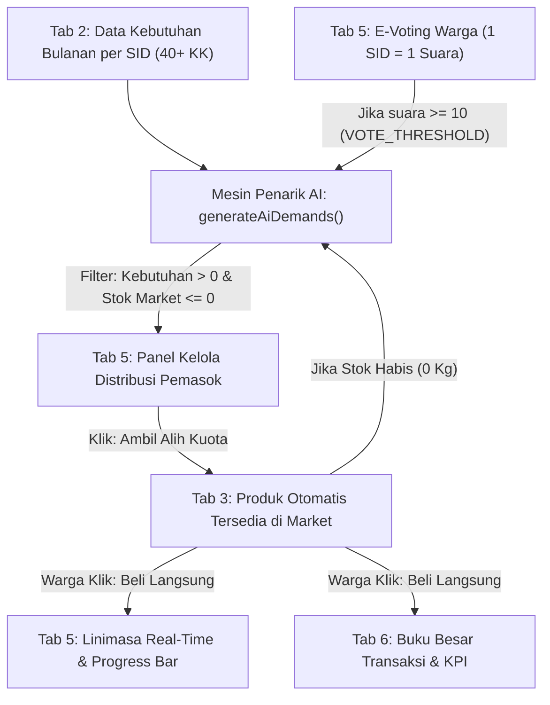

# DOKUMENTASI & PENJELASAN LENGKAP PROTOTIPE SI-PANGAN ID
## Sistem Pengatur Keseimbangan Pangan Mikro Berbasis Single Identity, Digital Food Inventory, Community AI, dan Smart Market

> **Lokasi Mitra Implementasi:** RT 13 RW 05 Kelurahan Yosomulyo, Kecamatan Metro Pusat, Kota Metro, Lampung  
> **Institusi Pengusul:** Universitas Muhammadiyah Metro (Kelanjutan Basis Data PKM-PM 2023)  
> **Status Kesiapan:** Purwarupa Fungsional — Siap Validasi Lapangan  
> **Arsitektur:** Single-File Web Application (`index.html`) • HTML5, Tailwind CSS CDN, Vanilla JavaScript, Chart.js v4, Tesseract.js v5 WebAssembly (Siap GitHub Pages tanpa proses *build*)

---

## DAFTAR ISI
1. [Konsep Inti & Nilai Inovasi (*Demand-Driven Production*)](#1-konsep-inti--nilai-inovasi-demand-driven-production)
2. [Alur Kerja Terintegrasi (Hulu ke Hilir)](#2-alur-kerja-terintegrasi-hulu-ke-hilir)
3. [Arsitektur Data (`window.appState` & State Transparansi)](#3-arsitektur-data-windowappstate--state-transparansi)
4. [Penjelasan Lengkap 6 Tab Fungsional](#4-penjelasan-lengkap-6-tab-fungsional)
   - [Tab 1: Alur & Arsitektur (`#tab-konsep`)](#tab-1-1-alur--arsitektur-tab-konsep)
   - [Tab 2: Single Identity / SID (`#tab-sid`)](#tab-2-2-single-identity-sid-tab-sid)
   - [Tab 3: Digital Inventory & Pasar (`#tab-market`)](#tab-3-3-digital-inventory--pasar-tab-market)
   - [Tab 4: Community AI (`#tab-matching`)](#tab-4-4-community-ai-tab-matching)
   - [Tab 5: Musyawarah Permintaan & Pemasok (`#tab-musyawarah`)](#tab-5-5-musyawarah-permintaan-tab-musyawarah)
   - [Tab 6: Evaluasi Dampak & Buku Besar (`#tab-dampak`)](#tab-6-6-evaluasi-dampak-tab-dampak)
5. [Penjelasan 6 Modal Interaktif & Komponen Global](#5-penjelasan-6-modal-interaktif--komponen-global)
6. [Skema Ekonomi: 0% Fee P2P Warga & Keberlanjutan Koperasi](#6-skema-ekonomi-0-fee-p2p-warga--keberlanjutan-koperasi)
7. [Skenario Uji Coba Lengkap & Panduan Demo Day (3 Menit)](#7-skenario-uji-coba-lengkap--panduan-demo-day-3-menit)

---

## 1. KONSEP INTI & NILAI INOVASI (*DEMAND-DRIVEN PRODUCTION*)

**SI-PANGAN ID** dibangun untuk mengatasi *supply-demand mismatch* di tingkat komunitas RT 13 Yosomulyo. Nilai inovasi terbesarnya adalah **mengubah pola produksi pangan dari sekadar memproduksi lalu mencari pembeli, menjadi mengetahui kebutuhan pasar terlebih dahulu, kemudian menyesuaikan produksi dan distribusi**.

Sistem ini berdiri di atas **4 Pilar Mekanisme Utama**:
1. **Single Identity (SID):** Identitas tunggal 40 KK (berbasis NIK terenkripsi SHA-256) yang memetakan profil sosio-ekonomi sekaligus **kebutuhan konsumsi pangan bulanan per komoditas per KK**.
2. **Digital Food Inventory:** Pencatatan jadwal tanam, estimasi tanggal panen, volume stok, dan batas kesegaran (*short shelf-life*) oleh petani pekarangan/KWT, dilengkapi pemindai OCR catatan panen fisik.
3. **Community AI:** Mesin analitik pengambilan keputusan (bukan sekadar *chatbot*) yang mencakup:
   - **AI Demand-to-Supplier Engine** (`generateAiDemands`) untuk menarik total kebutuhan bulanan dari seluruh SID dan E-Voting yang lolos ambang batas;
   - **k-NN / AI-DSS Scoring** untuk klasifikasi kerentanan rumah tangga;
   - **AI Food Matching (4 Parameter)** dengan rotasi *Round-Robin*;
   - **AI Surplus Prediction Engine** untuk mendeteksi surplus/defisit 3 hari ke depan;
   - **AI Market Fluctuation & Strict Dynamic Pricing** berbasis data komoditas Lampung.
4. **Smart Market & Hilirisasi Koperasi:** Pasar langsung produsen–konsumen dengan **0% Fee transaksi P2P internal warga** serta mekanisme pengalihan luapan surplus (*spillover*) ke **Koperasi Produsen Kelurahan Yosomulyo** guna menekan susut pangan (*food loss*).

---

## 2. ALUR KERJA TERINTEGRASI (HULU KE HILIR)

Berikut alur kerja *end-to-end* yang kini berjalan secara reaktif di dalam `index.html`:

1. **Hulu (Data Kebutuhan):** Setiap SID di Tab 2 memiliki rincian kebutuhan bulanan (`needs`), ditambah warga dapat mengajukan permintaan komoditas baru via E-Voting di Tab 5.
2. **Penarikan Cerdas (AI Demand Engine):** `generateAiDemands()` menjumlahkan kebutuhan seluruh SID dan menggabungkannya dengan item E-Voting yang mencapai `VOTE_THRESHOLD = 10` suara (`source: 'voting'`), lalu menyaring hanya komoditas yang stoknya belum tersedia atau habis di Market Tab 3 (`availableStockKg <= 0`).
3. **Pengambilalihan oleh Pemasok:** Pemasok melihat daftar peluang pasok tersebut di Tab 5 lalu mengklik **`Ambil Alih Kuota`**. Produk otomatis terbit di **Etalase Market (Tab 3)** dengan status **`Tersedia • Disuplai oleh [Nama Pemasok]`**.
4. **Transaksi & Transparansi:** Warga membeli langsung dari Market Tab 3 (`handleExecuteBuy()`). Stok etalase berkurang, 100% pembayaran masuk ke `walletEarned` produsen, serta transaksi langsung tercatat di **Linimasa Distribusi Tab 5** dan **Buku Besar Tab 6**. Jika stok habis menjadi `0 Kg`, AI otomatis memasukkannya kembali ke antrean Panel Pemasok.

---

## 3. ARSITEKTUR DATA (`window.appState` & STATE TRANSPARANSI)

Seluruh purwarupa digerakkan oleh satu sumber kebenaran di sisi klien (*Client-Side Single Source of Truth*) tanpa backend eksternal:

* **`window.appState.privacyMode`:** `'PUBLIC'` (nama dan NIK disamarkan untuk tampilan publik) atau `'ADMIN'` (nama lengkap dan status verifikasi pengurus RT 13).
* **`window.appState.danaSosialInklusi`:** Saldo kas swadaya inklusi pangan (`Rp 1.450.000` awal) untuk mendanai paket bantuan keluarga rentan prioritas.
* **`window.appState.members` (40 KK awal):** Setiap objek warga menyimpan `sid`, `name`, `publicName`, `nikHash`, `maskedNik`, `rawNik`, `role` (`'PRODUSEN'` / `'KONSUMEN'`), `producerCommodity`, `capacityKg`, `familySize`, `monthlyIncome`, `monthlyFoodNeedKg`, `socialTier`, `distanceKm`, `walletEarned`, `subsidyReceivedKg`, `address`, dan objek rincian bulanan **`needs`**:
  * Semua 40 KK memiliki `needs.beras`, `needs.sayur`, `needs.telur`, `needs.ikan`.
  * **10 KK acak** (`SID-RT13-002`, `005`, `008`, `011`, `012`, `018`, `021`, `023`, `029`, `030`) memiliki tambahan kebutuhan bulanan yang belum ada di Market Tab 3: **`ayam`** (*Daging Ayam Kampung / Potong*, total `28 Kg/bln`) dan **`tempe`** (*Tempe Daun & Tahu Segar*, total `31 Kg/bln`).
* **`window.appState.listings` (8 item awal):** Daftar produk aktif di Etalase Market Tab 3 (*Sayur Kangkung*, *Beras Ciherang*, *Telur Ayam*, *Ikan Lele*, *Cabai Rawit*, *Ikan Nila*, *Sayur Bayam*, *Telur Bebek*) lengkap dengan `availableStockKg`, `fairPrice`, `pengepulPrice`, `marketPrice`, `freshnessWindow`, dan `isFromQuotaTakeover`.
* **`window.appState.demands` (5 item awal):** Papan E-Voting warga (`dem-001` s.d. `dem-005`). `dem-002` (*Minyak Goreng*, 34 suara) dan `dem-003` (*Bawang Merah & Putih*, 25 suara) lolos threshold, sementara `dem-005` (*Tepung Terigu & Gula Pasir*) dimulai pada **9/10 suara (`VOTING`)** untuk demonstrasi penembusan ambang batas.
* **`window.appState.aiAggregatedDemands`:** Array hasil kalkulasi `generateAiDemands()` yang menggabungkan agregasi kebutuhan SID (`source: 'sid'`) dan item E-Voting lolos threshold (`source: 'voting'`).
* **`window.appState.transactions`:** Buku besar transaksi P2P, bantuan inklusi pangan, dan penyaluran *spillover* koperasi.
* **`musyawarahTransparencyState`:** State lokal Tab 5 untuk `currentProducer`, `distributionProgress` (`85%` awal), `swadayaUsed` (`Rp 1.450.000`), `quotaAlert` (*KWT Sumber Rejeki* kekurangan 5 kg Kangkung), dan `activities` (log Linimasa Real-Time).

---

## 4. PENJELASAN LENGKAP 6 TAB FUNGSIONAL

### Tab 1: `1. Alur & Arsitektur` (`#tab-konsep`)
Berfungsi sebagai ringkasan eksekutif arsitektur sistem di hadapan penguji/juri:
* **Narasi Benang Merah (*Demand-Driven*):** Menjelaskan transformasi dari produksi berbasis stok ke produksi berbasis permintaan via SID & Musyawarah Permintaan, memperpendek rantai distribusi, serta skema **0% Fee P2P warga** dengan keberlanjutan operasional melalui kurir komunitas dan bagi hasil Koperasi.
* **Kartu Sasaran Pengguna & Target Kinerja Uji Coba:** Menampilkan status **`Purwarupa Fungsional — Siap Validasi Lapangan`** beserta 4 metrik: `40 KK Terdata`, `20 Produsen KWT`, `Total Nilai Transaksi Pangan Warga` (`#tab1TotalTransaksi`), dan `>= 50 Transaksi`.
* **Alur Sirkularitas 5 Tahap (4 Pilar Inovasi):** Kartu 01 (*Single Identity*), 02 (*Digital Food Inventory*), 03 (*Community AI*), 04 (*Smart Market*), dan 05 (*Evaluasi Dampak & Ledger*).
* **Matriks Pembuktian DeepTech vs Metode Konvensional:** Membandingkan 4 inovasi inti (*Single Identity Deduplication*, *AI Multi-Factor Food Matching*, *Historical Surplus Prediction*, *Verified Ledger P2P (0% Komisi)*) beserta kolom **Target Validasi di RT 13 Yosomulyo**.

### Tab 2: `2. Single Identity (SID)` (`#tab-sid`)
Berfungsi sebagai basis data identitas tunggal & pemetaan konsumsi rumah tangga:
* **Ringkasan Konsumsi Harian 40 KK:** Menampilkan estimasi kebutuhan harian agregat lingkungan RT 13 (Sayuran Segar `24 Kg/hari`, Telur Unggas `80 Butir/hari`, Daging Ayam `12 Kg/hari`, Ikan Air Tawar `16 Kg/hari`).
* **Formulir Registrasi Warga & Uji Anti-Duplikasi (`#formRegisterMember`):**
  * Memuat **Uji Coba NIK Ganda** (`fillDuplicateNikTest`) yang memicu `#dedupAlertBanner` untuk membuktikan sistem menolak NIK duplikat (`SID-RT13-002`), serta **Contoh Data Acak** (`fillRandomCitizenData`).
  * Memiliki 6 input rincian kebutuhan komoditas bulanan (`#regNeedBeras`, `#regNeedSayur`, `#regNeedTelur`, `#regNeedIkan`, `#regNeedAyam`, `#regNeedTempe`) yang otomatis menjumlah ke `#regFoodNeedKg` (`syncNeedsToTotal`) dan menghitung skor kerentanan AI-DSS secara langsung (`autoDetectVulnerabilityTier`).
  * Saat warga baru didaftarkan (`handleRegisterMember`), datanya langsung ditambahkan ke `window.appState.members` dan otomatis memicu `generateAiDemands()` serta memperbarui Panel Pemasok Tab 5.
* **Direktori 40 KK dengan *Expandable Row* (`renderMembersTable`):**
  * Kolom utama yang tampil ringkas & *mobile-friendly* (`overflow-x-auto`): **Kode SID**, **Identitas (Masked)** (nama tersamar + NIK tersamar), **Status Kerentanan** (badge pill warna `rose` / `amber` / `emerald`), dan tombol **Lihat Detail** (`viewMemberDetail`).
  * Mengklik baris warga membuka **Expandable Row** (`toggleMemberRowExpand`) berisi Peran & Alamat (disertai badge `Sinyal Pasar: Terukur` bagi produsen), Tanggungan Keluarga (`Jiwa`), Jarak ke Hub (`km`), dan pill rincian kebutuhan bulanan (`Beras`, `Sayur`, `Telur`, `Ikan`, serta `Daging Ayam` & `Tempe/Tahu` bila > 0).
  * Dilengkapi pencarian instan (`#memberSearchInput`) dan filter kategori (`#memberFilterRole`).

### Tab 3: `3. Digital Inventory & Pasar` (`#tab-market`)
Menggabungkan **Digital Food Inventory**, **AI Forecasting**, dan **Smart Market P2P**:
* **Aksi Inventaris Cepat:** Tombol **`Pindai Kuitansi (OCR)`** (`#modalOcrScan`) dan **`Catat Hasil Panen / Persediaan KWT`** (`#modalNewListing`).
* **Filter Kategori & Sorotan Kasus:** Filter `Semua Komoditas`, `Sayur Pekarangan`, `Beras & Padi`, `Lauk & Protein`, dan `Olahan UMKM`, disertai 2 kartu sorotan proposal (*Sayur Kangkung KWT 80 Kg* & *Beras Ciherang Poktan 1 Ton*).
* **AI Market Fluctuation & Price Trend Forecaster (`#aiMarketFluctuationPanel`):**
  * Pemilih **11 komoditas lokal** (`FLUCTUATION_DATA`) yang menampilkan grafik garis **Chart.js** 11 titik waktu (**Historis H-7 s.d. Hari Ini** + **Proyeksi AI H+1 s.d. H+3**), perbandingan `Harga Pengepul` vs `Pasar Hari Ini` vs `Prediksi H+3`, serta kotak **AI Actionable Advisory** (rekomendasi taktis terpisah untuk Produsen dan Konsumen).
* **Etalase Produk Smart Market (`#marketListingsGrid` & `renderMarketListings`):**
  * Menampilkan badge `Rantai Pasok Pendek (SFSC)`, identitas produsen + jarak, tanggal panen, indikator kesegaran (*short shelf-life*), perbandingan harga pasar luar (*Hemat Rp...*), penonjolan **Harga Komunitas RT 13**, **Koridor Harga Adil Terkunci** (`Pengepul < Harga Komunitas < Pasar`), progress bar daya serap, dan tombol **`Beli Langsung (Konsumen RT 13)`** (`openBuyModal`).
  * Untuk produk yang berasal dari aksi **`Ambil Alih Kuota`** pemasok di Tab 5, kartu menampilkan badge **`Tersedia • Disuplai oleh [Nama Pemasok]`**.
  * Jika `availableStockKg <= 0`, tombol pembelian dinonaktifkan (`Stok Habis (Masuk Antrean Permintaan AI)`).
  * Untuk Beras Poktan (`list-002`) yang memiliki surplus tak terserap lokal (`400 Kg`), tersedia tombol **`Salurkan Surplus 400 Kg ke Koperasi`** (`#modalSurplusSpillover`).

### Tab 4: `4. Community AI` (`#tab-matching`)
Menjalankan fungsi analitik pengambilan keputusan distribusi & keseimbangan pasokan:
* **Mesin Pencocokan Cerdas / AI Food Matching (`renderAiMatchingPanel`):**
  * Memfilter warga klaster `RENTAN_PRIORITAS`, menghitung skor kerentanan (`calculateAiVulnerability`), dan menerapkan **Rotasi Pemerataan (*Round-Robin*)** sehingga warga yang belum menerima bantuan bulan ini (`aidReceivedThisMonth === false`) ditempatkan di prioritas teratas.
  * Menjodohkan penerima dengan paket pangan bergizi lokal berdasarkan 4 parameter: **Kesesuaian Gizi, Keterjangkauan Harga, Jarak Terdekat, dan Kesegaran**.
  * Mengklik **`Eksekusi Penyaluran Bantuan Inklusif`** (`executeFoodAid`) memotong saldo `danaSosialInklusi`, menandai warga sebagai terpenuhi bulan ini (`Rotasi Selesai`), dan mencatat transaksi ke Buku Besar.
* **Simulator AI Surplus Prediction Engine (`calculateSurplusPrediction`):**
  * Menghitung keseimbangan antara *Estimasi Total Panen* (`#surplusHarvestKg`) vs *Kebutuhan Konsumsi 40 KK* (`#surplusDemandKg`), menampilkan bar rasio **Serapan Lokal RT 13** vs **Spillover Pasar Luar**, dan banner rekomendasi aksi AI.
  * Dilengkapi 3 tombol **Preset Skenario Proposal**: *Surplus Sayur KWT (80 Kg, +20 Kg ke Koperasi)*, *Defisit Telur Ayam (50 Butir, -30 Butir Tetangga)*, dan *Kasus Bapak A Beras 1.000 Kg (Surplus 400 Kg ke Koperasi)*.

### Tab 5: `5. Musyawarah Permintaan` (`#tab-musyawarah`)
Terdiri dari 3 bagian terintegrasi untuk transparansi, agregasi permintaan AI, dan demokrasi pangan:
* **Bagian A — Musyawarah & Transparansi Distribusi Pangan:**
  * **3 Kartu Overview:** *Progres Distribusi Bulan Ini* (`#musyawarahProgressPct` & `#musyawarahProgressBar`, awal `85%`), *Dana Kas Swadaya Terpakai* (`Rp 1.450.000`), dan *Status Surplus/Defisit* (`#musyawarahStatusBadge` dinamis).
  * **Linimasa Distribusi Real-Time (`#musyawarahTimelineList`):** Feed vertikal log penyaluran & transaksi Market (`renderMusyawarahTimeline`) dengan ikon centang hijau dan waktu relatif.
  * **Forum Intervensi (*Kendala & Pengalihan Kuota*):** Alert card kendala kekurangan 5 kg Sayur Kangkung oleh *KWT Sumber Rejeki*. Mengklik **`Ambil Alih Kuota`** (`handleTakeOverQuota`) menyelesaikan alert menjadi *Kuota Seimbang*, menaikkan progress bar, mengubah status menjadi `Aman`, dan menambah entri baru di Linimasa.
* **Bagian B — Panel Kelola Distribusi Pemasok (*AI Demand-to-Supplier Engine*):**
  * Memuat pemilih pemasok aktif (`#supplierActorSelect`: *KWT Mekar Jaya*, *Ibu Sartika*, *Ibu Sri Wahyuni*, *Pak Hendra*, *Pak Joko*, *Ibu Dewi*) yang langsung disinkronkan ke seluruh aksi Tab 5.
  * Tabel `#aiSupplierDemandsTableBody` (`renderSupplierDistributionPanel`) menampilkan daftar komoditas dari `window.appState.aiAggregatedDemands` **hanya jika `totalKg > 0` dan `marketStockKg <= 0`**.
  * Membedakan sumber permintaan dengan pill **`Agregasi SID Rutin`** (`source: 'sid'`) dan badge gradien api **`🔥 Hasil Voting Warga`** (`source: 'voting'`).
  * Mengklik **`Ambil Alih Kuota`** (`handleClaimCommodityQuota`) langsung menerbitkan komoditas tersebut ke Market Tab 3 sebagai item `Tersedia • Disuplai oleh [Nama Pemasok]`, menghapusnya dari antrean Panel Pemasok, dan mencatatnya ke Linimasa.
* **Bagian C — Musyawarah Permintaan Konsumen & Master Katalog Admin:**
  * Form **Tambah Komoditas Permintaan Baru** (`#formAddDemandCatalog` & `handleAddDemandCatalog`) dengan pencegahan duplikasi *case-insensitive*. Item baru dimulai di status `VOTING` (1 suara).
  * Papan **E-Voting (1 SID = 1 Suara)** (`#demandVotingCardsContainer` & `renderDemandsBoard`) dengan konstanta `VOTE_THRESHOLD = 10`:
    * Selama `votes < 10`: berstatus **`Voting (X/10 Suara)`**.
    * Saat `votes >= 10` (`handleVoteDemand`): otomatis berubah menjadi **`Menunggu Pemasok`** dan langsung diinjeksi ke `window.appState.aiAggregatedDemands` (`source: 'voting'`) di Panel Pemasok Tab 5.

### Tab 6: `6. Evaluasi Dampak` (`#tab-dampak`)
Berfungsi sebagai dashboard akuntabilitas dan hasil hilirisasi ekosistem:
* **5 KPI Dampak Agregat:** *Total Pangan* (`#kpiTotalPanganKg`), *Surplus Terserap* (`89,2%`), *Biaya & Jarak Rata-Rata* (`0,38 km`, ongkir rata-rata `Rp 1.250`), *Penerima Bantuan* (`5 KK`), dan *Total Nilai Transaksi Warga* (`#kpiProdusenTurnover`, 0% Fee transaksi P2P warga).
* **2 Grafik Chart.js (`updateCharts`):**
  1. `#chartSurplusAbsorption`: Grafik batang bertumpuk (*Stacked Bar*) perbandingan serapan lokal RT 13, alokasi surplus pasar luar, dan sisa stok untuk 5 komoditas.
  2. `#chartFundFlow`: Grafik donat alokasi nilai transaksi antara *Pendapatan Produsen Lokal (100%)*, *Penyaluran Bantuan Pangan*, dan *Cadangan Lumbung Komunitas*.
* **Buku Besar Transaksi & Distribusi Terverifikasi (`#ledgerTableBody`):** Tabel responsif (`overflow-x-auto`) mencatat seluruh mutasi dengan filter jenis transaksi (`#ledgerTypeFilter`: `Jual Beli Pasar Komersial`, `Bantuan Inklusi Pangan`, `Ekspansi Surplus ke Luar RT`).

---

## 5. PENJELASAN 6 MODAL INTERAKTIF & KOMPONEN GLOBAL

1. **Modal Detail Warga (`#modalMemberDetail`):** Menampilkan avatar inisial, SID, NIK (masked/admin), hash SHA-256, peran, tier kerentanan, alamat, jarak, serta ringkasan riwayat & kebutuhan pangan bulanan per komoditas.
2. **Modal Beli Langsung P2P (`#modalBuyDirect` & `handleExecuteBuy`):** Memilih pembeli berdasarkan SID (`#buyConsumerSidSelect`), kuantitas, dan opsi kirim (`Ambil Sendiri Rp 0`, `Diantar Produsen +Rp 2.000`, atau `Kurir Komunitas RT +Rp 5.000`). Menampilkan rincian bahwa **100% harga komoditas diterima produsen (0% Fee)**. Setiap pembelian otomatis memotong stok Market, menambah dompet produsen, dan mencatat log ke **Linimasa Tab 5** serta **Buku Besar Tab 6**.
3. **Modal Penyaluran Surplus (`#modalSurplusSpillover` & `handleExecuteSurplusSpillover`):** Menyalurkan luapan surplus `400 Kg` Beras Pak Hendra ke *Koperasi Produsen Kelurahan Yosomulyo*, *Pasar Antar-RT*, atau *Cadangan Pangan Komunitas Metro*.
4. **Modal Catat Hasil Panen & Dynamic Pricing (`#modalNewListing` & `handleCreateListing`):** Mengunci otomatis batas bawah (`Harga Pengepul`) dan batas atas (`Harga Pasar`) dari `LAMPUNG_MARKET_INTELLIGENCE`, memvisualisasikan posisi harga jual pada **Dynamic Pricing Gauge Bar**, serta menolak harga rugi atau harga inflasi secara *real-time* (`validateDynamicPricing`).
5. **Modal Demo Day Pitch Timer (`#modalPitchTimer`):** Pengatur waktu presentasi bawaan dengan preset `7m Pitch`, `3m Demo`, dan `10m Q&A`.
6. **Modal Pemindai OCR (`#modalOcrScan`):** Menggunakan **Tesseract.js v5 WebAssembly** untuk membaca foto catatan panen/kuitansi secara lokal di browser, dilengkapi 2 tombol sampel cepat (*Catatan Panen Bayam* & *Timbangan Beras*) dan tombol **`Gunakan Data untuk Posting Panen Baru`** (`applyOcrToListingForm`) yang langsung mengisi form listing Tab 3.
7. **Komponen Global:** Top Bar (*Total Transaksi Warga*, *Skema Platform: 0% Fee P2P Warga*, *Pangan Tersalurkan*, tombol *Mode Privasi*, *Demo Timer*, *Cetak Laporan*), Sidebar responsif (`sticky` di desktop & drawer lipat di mobile), favicon inline SVG logo SI-PANGAN ID, serta sistem notifikasi `showToast`.

---

## 6. SKEMA EKONOMI: 0% FEE P2P WARGA & KEBERLANJUTAN KOPERASI

Agar selaras antara pemberdayaan ekonomi warga dan model bisnis sosial jangka panjang:
* **Transaksi P2P Internal RT 13 (0% Fee):** Warga yang membeli hasil panen produsen lokal di Market RT 13 tidak dikenakan potongan komisi platform—**100% nilai produk langsung masuk ke dompet produsen (`walletEarned`)**.
* **Keberlanjutan Operasional Ekosistem:** Didukung oleh **layanan kurir komunitas** (ongkos kirim opsional Rp 5.000 pada modal beli) serta **bagi hasil pengelolaan luapan surplus panen (*spillover*)** oleh **Koperasi Produsen Kelurahan Yosomulyo** ke pasar eksternal.
* **Framing Rantai Pasok Pendek (SFSC):** Seluruh antarmuka secara konsisten menekankan upaya *memperpendek rantai distribusi dan mengurangi ketergantungan pada perantara yang tidak memberi nilai tambah*, menjaga koridor harga adil antara batas harga pengepul dan harga pasar kota.

---

## 7. SKENARIO UJI COBA LENGKAP & PANDUAN DEMO DAY (3 MENIT)

### Checklist Uji Coba Fungsional Mandiri
1. **Uji Anti-Duplikasi & Agregasi SID (Tab 2 → Tab 5):**
   - Buka Tab 2, klik **`Uji Coba NIK Ganda`** → sistem menolak NIK duplikat (`SID-RT13-002`).
   - Klik **`Contoh Data Acak`**, ubah input kebutuhan komoditas (misal `Daging Ayam = 5`), lalu submit → warga ke-41 terbit dan total kebutuhan `Daging Ayam` di Panel Pemasok Tab 5 langsung bertambah (`28 Kg → 33 Kg`).
   - Klik salah satu baris tabel warga di Tab 2 → baris terbuka (*Expandable Row*) menampilkan tanggungan, jarak, dan rincian konsumsi bulanan per komoditas.
2. **Uji AI Demand Engine & E-Voting Threshold (Tab 5 → Tab 3 → Tab 5):**
   - Buka Tab 5 Bagian B (*Panel Kelola Distribusi Pemasok*) → terlihat **Daging Ayam (`10 KK • 28 Kg`)** dan **Tempe Daun & Tahu (`10 KK • 31 Kg`)** dengan status *Menunggu Pemasok*, serta **Minyak Goreng** & **Bawang Merah** berlabel **`🔥 Hasil Voting Warga`**.
   - Gulir ke Bagian C (E-Voting) pada kartu **Tepung Terigu & Gula Pasir** (`9/10 Suara`, status *Voting*) → klik **`Beri Suara Permintaan`** 1 kali → suara menjadi `10`, status berubah menjadi **`Menunggu Pemasok`**, dan komoditas tersebut otomatis muncul di Panel Pemasok Bagian B dengan badge **`🔥 Hasil Voting Warga`**.
   - Klik **`Ambil Alih Kuota`** pada salah satu komoditas di Panel Pemasok → komoditas hilang dari antrean Panel Pemasok dan langsung muncul di **Tab 3 Market** dengan badge **`Tersedia • Disuplai oleh KWT Mekar Jaya`**.
   - Buka Tab 3, klik **`Beli Langsung`** pada produk tersebut → setelah transaksi berhasil, kembali ke Tab 5 dan lihat transaksi otomatis muncul di urutan paling atas **Linimasa Distribusi Real-Time** serta **Buku Besar Tab 6**.
3. **Uji OCR, Dynamic Pricing & Food Matching (Tab 3 & Tab 4):**
   - Di Tab 3, uji **Pindai Kuitansi (OCR)** → klik *Catatan Panen Bayam* → klik *Gunakan Data untuk Posting Panen Baru* → lihat harga batas bawah & atas terkunci otomatis; coba ketik harga di bawah pengepul atau di atas pasar untuk melihat validasi penolakan real-time.
   - Di Tab 4, uji tombol preset **Surplus Sayur**, **Defisit Telur**, dan **Kasus Bapak A**, lalu eksekusi salah satu alokasi **AI Food Matching** untuk melihat rotasi *Round-Robin* berpindah ke warga rentan berikutnya.

### Ringkasan Skenario Pitching 3 Menit untuk Dewan Juri

| Waktu | Tab yang Ditampilkan | Poin Kunci Narasi Presentasi |
| :---: | :--- | :--- |
| **00:00 – 00:40** | **1. Alur & Arsitektur** | Tekankan nilai inovasi *Demand-Driven Production*: bukan sekadar *marketplace*, melainkan sistem yang memetakan kebutuhan warga lebih dulu sebelum mengatur produksi dan distribusi melalui 4 pilar (*Single Identity → Digital Food Inventory → Community AI → Smart Market*) dengan status **Purwarupa Fungsional — Siap Validasi Lapangan**. |
| **00:40 – 01:25** | **2. Single Identity (SID)** | Klik salah satu baris warga untuk membuka *Expandable Row* rincian konsumsi bulanan per komoditas (`needs`), tunjukkan anti-duplikasi NIK (SHA-256) dan kalkulasi kerentanan k-NN yang adil bagi konsumen maupun produsen kecil. |
| **01:25 – 02:20** | **5. Musyawarah → 3. Pasar** | Tunjukkan AI otomatis menarik kebutuhan 10 KK yang belum ada di Market (*Daging Ayam* & *Tempe/Tahu*) serta klik 1x Vote *Tepung & Gula* (9→10 suara) untuk menembus `VOTE_THRESHOLD`. Klik **`Ambil Alih Kuota`**, tunjukkan produk langsung **Tersedia** di Tab 3 Market, lalu lakukan pembelian warga dan tunjukkan lognya langsung masuk ke **Linimasa Tab 5**. |
| **02:20 – 03:00** | **4. Community AI & 6. Evaluasi Dampak** | Tunjukkan AI berfungsi sebagai pengambil keputusan (*Food Matching* 4 parameter + *Surplus Prediction* penyaluran *spillover* ke Koperasi Kelurahan Yosomulyo), grafik dampak, dan Buku Besar P2P **0% Fee** teraudit. |
